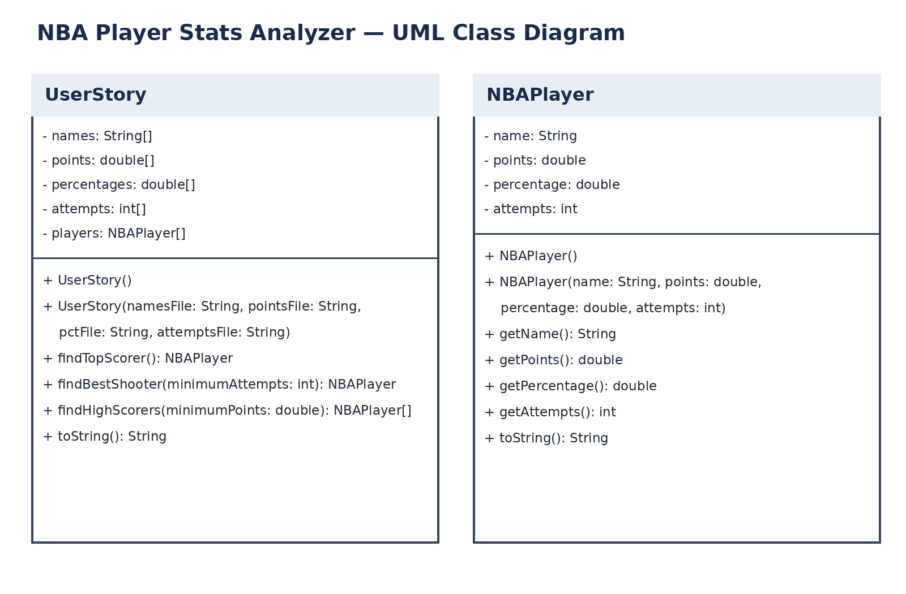

# NBA Player Stats Analyzer

**Authors:** Ansh Talwar and Jai Singh

## Introduction

The NBA Player Stats Analyzer is a Java program that analyzes NBA player statistics from the 2026-2027 NBA season. It helps basketball fans identify the highest-scoring players and the most efficient shooters using real basketball data.

## Requirements

This project uses object-oriented programming, one-dimensional (1D) arrays, algorithms, and data from text files to answer questions about NBA player performance.

The program includes:
- Classes with no-argument and parameterized constructors
- Multiple 1D arrays storing NBA player statistics
- Algorithms that traverse arrays to analyze player performance
- A new array created from existing player data
- A `toString()` method that summarizes the dataset
- Multiline comments explaining the methods and their purposes

## User Story

As an NBA fan, I want to analyze NBA player statistics so that I can identify the best scorers and most efficient shooters.

**Question 1:** Which NBA player has the highest points per game average?

**Question 2:** Which NBA player has the highest field goal percentage?

For the second question, our program considers players with at least 100 field goal attempts to avoid selecting players with very small shooting samples.

## Dataset

**Source:** BoxScore Lab

https://boxscorelab.com/downloads/

**Dataset:** 2026-2027 NBA Player Season Totals

The dataset contains 462 player records and is divided into four text files.

| File | Data | Type |
|---|---|---|
| `player_names.txt` | NBA player names | String |
| `points_pg.txt` | Points per game | double |
| `field_goal_pct.txt` | Field goal percentage | double |
| `field_goal_attempts.txt` | Total field goal attempts | int |

The field goal percentages are stored as decimals and multiplied by 100 when displayed.

## UML Diagram

## Description

Our program uses three Java classes: `DataRunner`, `UserStory`, and `NBAPlayer`.

**DataRunner.java:** Contains the `main()` method, creates the UserStory object, and displays the results of the analysis.

**UserStory.java:** Uses the FileReader class to load NBA player statistics into multiple 1D arrays. It creates an additional array of NBAPlayer objects and analyzes the statistics using loops and conditional statements.

The `findTopScorer()` method traverses the player array to find the player with the highest points per game.

The `findBestShooter()` method identifies the player with the highest field goal percentage among players who attempted at least 100 shots.

The `findHighScorers()` method creates a new array containing players averaging at least 20 points per game.

The `toString()` method returns general information about the dataset.

**NBAPlayer.java:** Represents an individual NBA player and stores their name, points per game, field goal percentage, and field goal attempts. It includes constructors, accessor methods, and a `toString()` method.

### Results

Based on our dataset:

- Highest points per game: Luka Doncic — 39.3 PPG
- Highest field goal percentage (minimum 100 attempts): Walker Kessler — 69.1%
- Players averaging at least 20 PPG: 43

These results reflect the downloaded dataset and may change as the NBA season progresses.

